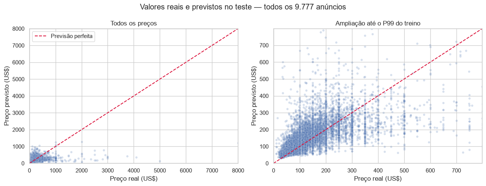
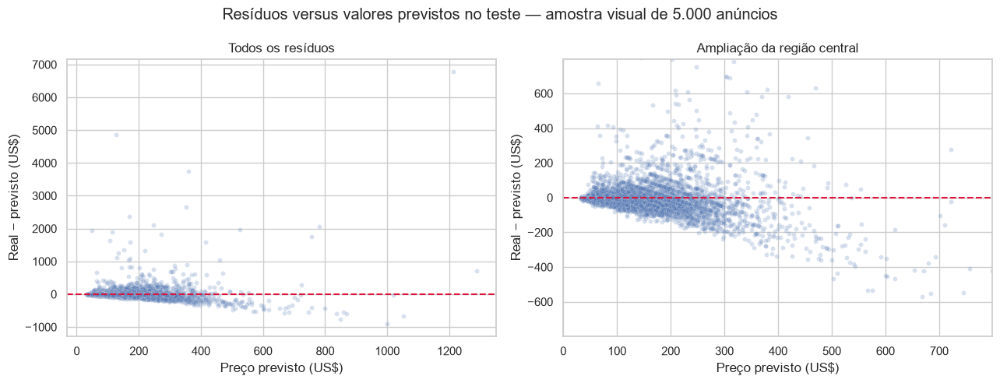
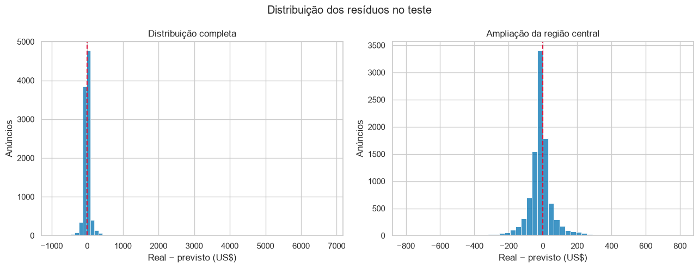

# APS2 — avaliação no teste reservado

O teste contém 9.777 anúncios que não participaram do ajuste dos modelos, do pré-processamento por fold nem da seleção de hiperparâmetros. A avaliação usa uma única previsão por anúncio e mantém o preço na escala de dólares.

| Métrica | Resultado no teste |
|---|---:|
| MAE | **US$ 63,08** |
| RMSE | US$ 176,74 |
| R² | 0,220 |

O MAE representa o erro absoluto médio por anúncio neste recorte. O RMSE bem maior revela a influência de erros extremos, e o R² indica que ainda resta variação relevante do preço que o modelo não explica.

## Valores reais e previstos

O painel da esquerda mantém toda a amplitude de preços. O da direita amplia a faixa até o percentil 99 do preço **do treino**; os dados foram limitados apenas na visualização, não na avaliação. As previsões acompanham parte da variação central, mas ficam muito abaixo de alguns preços reais extremos.

## Resíduos

O resíduo é definido como **preço real menos preço previsto**. Um valor positivo indica subestimação pelo modelo.

Os painéis completos mostram erros positivos muito altos: nesses anúncios, o modelo **subestimou** o preço anunciado. As ampliações revelam a massa principal perto de zero e deixam clara a assimetria da cauda. Os dispersogramas, as métricas e o histograma usam todos os **9.777 anúncios do teste**; as ampliações limitam somente a região visível.

## Erro por segmento

Os cortes das faixas de preço foram calculados no treino: mediana de **US$ 106** e P90 de **US$ 269**.

| Faixa do preço real | Anúncios | MAE (US$) | Resíduo mediano (US$) |
|---|---:|---:|---:|
| Até a mediana do treino | 4.883 | 31,99 | -17,06 |
| Da mediana ao P90 | 3.913 | 55,09 | -15,20 |
| Acima do P90 | 981 | **249,66** | **+123,17** |

O erro para anúncios acima do P90 é quase oito vezes o erro da faixa até a mediana. O resíduo mediano positivo nessa faixa confirma a tendência de subestimação dos anúncios caros.

### Tipo de acomodação

| Tipo | Anúncios | MAE (US$) |
|---|---:|---:|
| Acomodação inteira | 5.039 | 88,77 |
| Quarto compartilhado | 226 | 53,93 |
| Quarto privado | 4.512 | 34,84 |

### Borough

| Borough | Anúncios | MAE (US$) |
|---|---:|---:|
| Manhattan | 4.316 | 80,88 |
| Staten Island | 81 | 79,77 |
| Brooklyn | 4.036 | 51,76 |
| Queens | 1.120 | 39,77 |
| Bronx | 224 | 34,55 |

Acomodações inteiras e anúncios de Manhattan têm erro maior que seus grupos de comparação. O resultado de Staten Island tem apenas **81 anúncios** e, por isso, é menos estável. Esses grupos são diagnósticos posteriores à seleção e não foram usados para alterar o modelo.

[Interpretação do modelo](interpretacao.md){ .md-button .md-button--primary }
