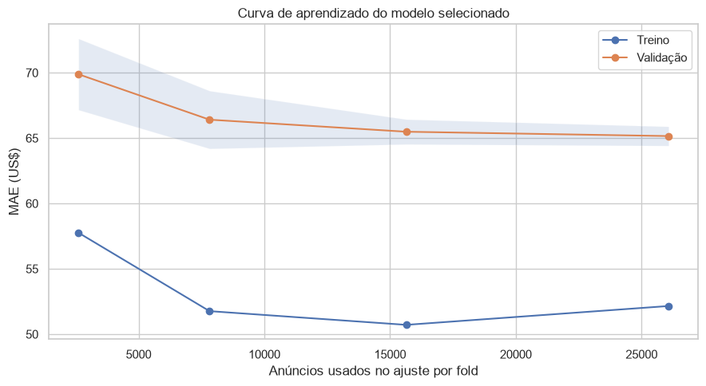

# APS2 — protocolo e comparação de modelos

**Entrega:** 26/10/2026 · **Autor:** Djairo Dantas da Silva Filho

## Pergunta e ligação com a APS1

O objetivo é prever o **preço anunciado por noite em US$** de um anúncio Airbnb em Nova York no recorte de 2019. A [APS1](../dados.md) auditou o dataset, removeu 11 preços não positivos e definiu as variáveis e o pré-processamento. A APS2 reproduz a mesma limpeza e a divisão de **39.107 anúncios para treino e 9.777 para teste**.

O teste ficou reservado até a escolha do modelo. Cada fold da validação ajusta uma cópia nova do `ColumnTransformer` da APS1 junto ao estimador, para que medianas, escalas e categorias sejam aprendidas somente dentro do treino do fold. [O scikit-learn recomenda pipelines para manter essa separação.](https://scikit-learn.org/stable/modules/compose)

## Protocolo

| Decisão | Implementação | Motivo |
|---|---|---|
| Target | `price`, na escala original de dólares | Mantém a interpretação do erro e isola a mudança no encoder. |
| Métrica principal | MAE em US$ | Mede o erro absoluto médio em unidade compreensível. |
| Validação | Três folds de `KFold`, embaralhados com semente 42 | Mesmo protocolo para os modelos e as buscas. |
| Baseline | `DummyRegressor` com mediana | Define o desempenho mínimo de referência. |
| Modelo linear | `Ridge` | Inclui regularização de coeficientes. |
| Ensemble | `RandomForestRegressor` | Captura relações e interações não lineares. |
| Mudança no pipeline | Agrupamento de categorias com frequência menor que 20 | Investiga a alta cardinalidade de bairros identificada na APS1. |

O Ridge é ajustado com `GridSearchCV` em cinco valores de `alpha`. A floresta usa `RandomizedSearchCV` com oito combinações de profundidade, mínimo de observações por folha e fração de variáveis por divisão. Todos os candidatos são avaliados pelo mesmo MAE e nos mesmos folds. O agrupamento de categorias raras é aprendido dentro de cada fold com o [`OneHotEncoder`](https://scikit-learn.org/stable/modules/generated/sklearn.preprocessing.OneHotEncoder.html).

## Resultados da validação

| Modelo | MAE inicial CV (US$) | Desvio entre folds (US$) | Melhor MAE após busca (US$) |
|---|---:|---:|---:|
| Dummy, mediana | 84,43 | 2,35 | Não se aplica |
| Ridge | 72,74 | 1,21 | 72,13 |
| Floresta aleatória | **65,63** | 1,10 | **65,14** |

Todos os modelos preditivos superaram o Dummy. A floresta apresentou o menor MAE inicial e após a seleção de hiperparâmetros. Como os valores de validação também participaram da escolha, o desempenho final é medido separadamente no teste.

### Efeito da mudança no pipeline

| Floresta ajustada | MAE médio nos mesmos folds (US$) |
|---|---:|
| Pré-processamento da APS1 | 65,14 |
| Categorias raras agrupadas | **65,04** |

O agrupamento reduziu o MAE em apenas **US$ 0,09**. A versão nova foi escolhida pela regra definida previamente de menor MAE médio, mas a diferença é pequena demais para afirmar um ganho material com base nestes três folds. O tratamento explícito de bairros raros e categorias inéditas continua sendo útil para a aplicação do pipeline.

O Ridge selecionou `alpha=100`. Na floresta original, a busca selecionou `max_depth=20`, `min_samples_leaf=5` e `max_features=0.5`; após o agrupamento, selecionou `max_depth=30`, `min_samples_leaf=5` e `max_features=0.5`. Ambas usam 100 árvores, `max_samples=0.8` e semente 42.

## Curva de aprendizado e robustez

À medida que o ajuste passa de cerca de 2,6 mil para 26 mil anúncios por fold, o MAE de validação cai de **US$ 69,89** para **US$ 65,16**. No maior tamanho, o MAE de treino é **US$ 52,16**: ainda há uma diferença de aproximadamente US$ 13 para a validação. A curva de validação se aproxima de um patamar, sem indicar que mais dados do mesmo tipo, por si só, eliminariam o erro.

### Anfitriões novos como teste de robustez

No split original, **2.981 dos 9.777 anúncios de teste (30,5%)** pertencem a anfitriões presentes no treino. Em uma validação complementar por `host_id`, feita somente no treino, o MAE foi **US$ 67,79 ± 3,18**. O valor é maior que os US$ 65,04 da validação aleatória, sugerindo sensibilidade a anfitriões novos; como os protocolos diferem e há variação entre folds, essa diferença deve ser tratada como diagnóstico, não como estimativa precisa de causalidade.

O [notebook executado](notebook.md) mostra os parâmetros selecionados, os scores por etapa e o código completo.

[Avaliação no teste](avaliacao.md){ .md-button .md-button--primary }
[Notebook completo](notebook.md){ .md-button }
