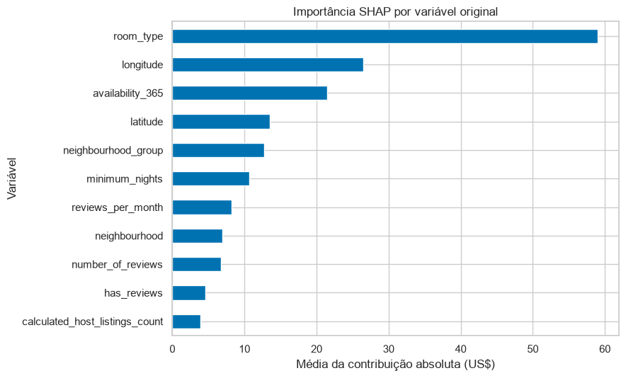
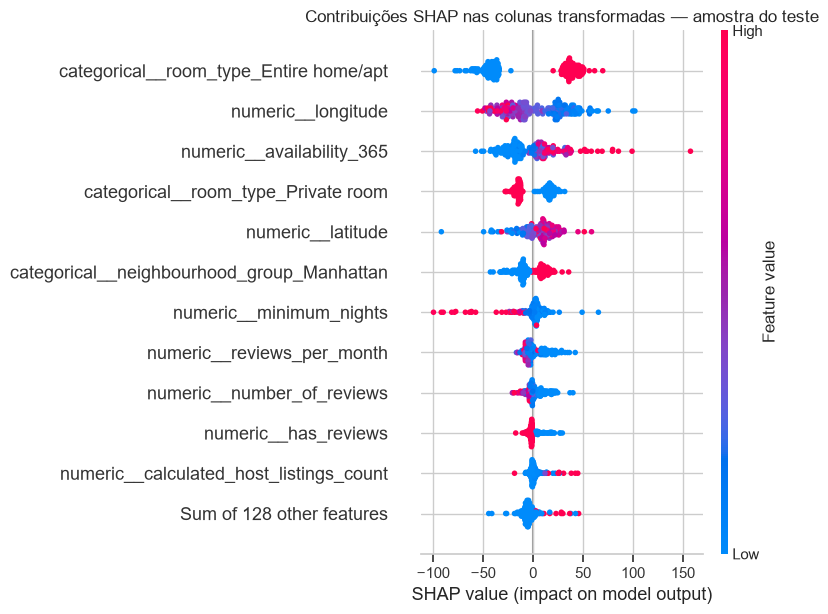
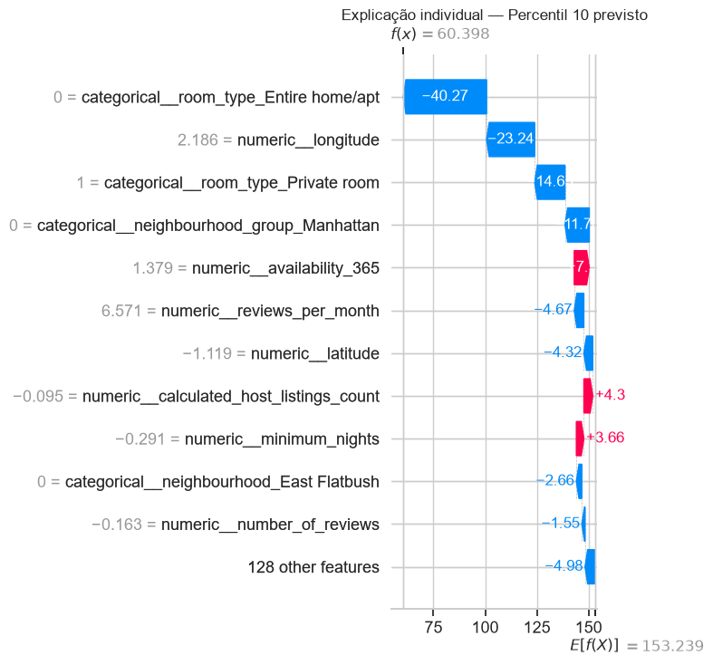
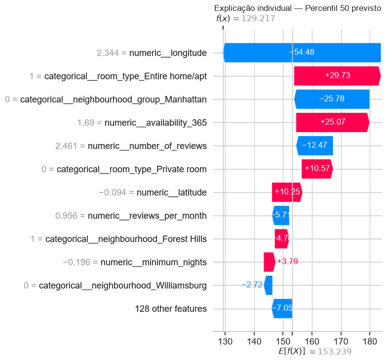
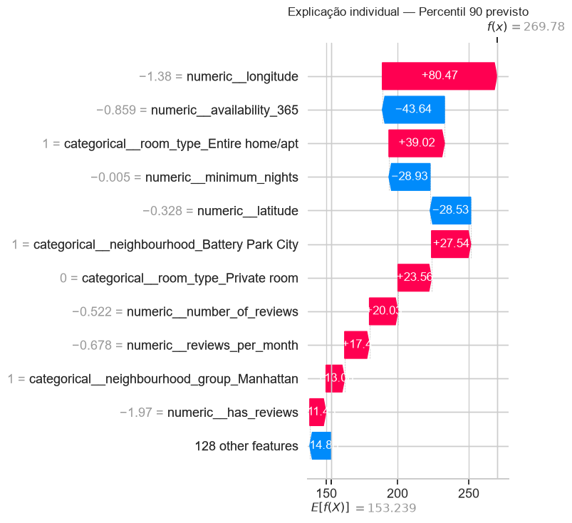

# APS2 — interpretação e discussão crítica

## Coeficientes e importância das árvores

| Modelo | Três maiores valores na medida própria do modelo |
|---|---|
| Ridge, coeficientes absolutos | Tribeca: **+US$ 167,37**; acomodação inteira: **+US$ 78,56**; Manhattan: **+US$ 64,89**. |
| Floresta, importância por impureza | Longitude: **0,209**; latitude: **0,147**; disponibilidade anual: **0,126**. |

Os coeficientes do Ridge representam mudanças na escala das variáveis **transformadas**; colunas numéricas foram padronizadas, enquanto as colunas one-hot representam categorias. A importância interna da floresta mede redução de impureza e pode favorecer variáveis com mais possibilidades de corte. Essas medidas explicam o ajuste, mas não demonstram causalidade. [O scikit-learn documenta a limitação da importância por impureza.](https://scikit-learn.org/stable/auto_examples/ensemble/plot_forest_importances.html)

## SHAP do modelo escolhido

O modelo final é a **floresta com agrupamento de categorias raras**. A análise global com `TreeExplainer` usa **200 anúncios do teste** escolhidos com semente fixa; três anúncios adicionais são explicados individualmente. As contribuições SHAP foram calculadas nas colunas transformadas e depois somadas por variável original; valor-base mais contribuições reconstrói as previsões com diferença numérica inferior a US$ 0,01.

Nos gráficos detalhados, os números ao lado das variáveis numéricas estão na escala **padronizada** usada pelo modelo, não em graus de latitude/longitude ou dias originais. As contribuições horizontais, por sua vez, estão em US$.

As maiores contribuições absolutas médias por variável original são **tipo de acomodação (US$ 58,99)**, **longitude (US$ 26,47)** e **disponibilidade anual (US$ 21,45)**. A divergência parcial em relação ao ranking por impureza mostra que as medidas resumem aspectos diferentes do ajuste. [Documentação do `TreeExplainer`.](https://shap.readthedocs.io/en/latest/generated/shap.TreeExplainer.html)

### Três previsões individuais

As previsões correspondem a valores próximos dos percentis 10, 50 e 90 do **preço previsto** no teste; a escolha não dependeu de acertarem ou errarem o preço real.

| Caso | Previsto | Real | Três maiores contribuições por variável original |
|---|---:|---:|---|
| Baixo | US$ 60,40 | US$ 65,00 | Tipo: **-54,37**; longitude: **-23,24**; borough: **-12,02**. |
| Mediano | US$ 129,22 | US$ 168,00 | Longitude: **-54,48**; tipo: **+41,24**; borough: **-27,64**. |
| Alto | US$ 269,78 | US$ 195,00 | Longitude: **+80,47**; tipo: **+63,28**; disponibilidade: **-43,64**. |

As figuras mostram por que **o modelo** produziu cada valor, inclusive no caso alto, em que superestimou o preço real em US$ 74,78. Uma explicação fiel da previsão não garante uma previsão correta.

## Duas limitações do modelo

1. **Incerteza individual ausente.** A previsão é pontual. O MAE do conjunto não fornece um intervalo de preço calibrado para um anúncio específico; modelos quantílicos e cobertura em dados reservados seriam uma próxima etapa. [Exemplo de intervalos de previsão no scikit-learn.](https://scikit-learn.org/stable/auto_examples/ensemble/plot_gradient_boosting_quantile.html)
2. **Atribuição instável entre variáveis relacionadas.** Localização aparece como coordenadas, borough e bairro. Quando variáveis estão associadas, coeficientes, importância das árvores e SHAP podem distribuir a contribuição de modos diferentes. As explicações descrevem o modelo ajustado, não efeitos causais. [O scikit-learn mostra como a correlação afeta medidas de importância.](https://scikit-learn.org/stable/auto_examples/inspection/plot_permutation_importance_multicollinear.html)

## Duas limitações adicionais dos dados

1. **Localização aproximada.** [O Inside Airbnb informa](https://insideairbnb.com/data-assumptions/) que as coordenadas disponibilizadas são anonimizadas, podendo se afastar do endereço real. Relações de micro-localização ficam imprecisas.
2. **Anúncios dependentes por anfitrião.** Um `host_id` pode possuir vários anúncios. No split da APS1, anúncios de um mesmo anfitrião podem aparecer em treino e teste. A [comparação por `GroupKFold`](index.md) mede a sensibilidade a anfitriões não vistos.

## Duas ações de operação e manutenção

1. **Monitorar dados novos rotulados.** Acompanhar MAE, resíduos e volume por borough, tipo de acomodação e faixa de preço; investigar degradação e mudanças de distribuição antes de decidir por novo ajuste.
2. **Versionar e revalidar antes de substituir.** Registrar versão do CSV, código, hiperparâmetros e métricas. Ao obter novos preços verificados, retreinar, comparar em um conjunto reservado recente e manter registro da versão implantada.

O conjunto representa preços **anunciados** em 2019. Não mede preço pago, ocupação ou receita e não descreve o mercado atual. Veja também as [limitações levantadas na APS1](../limitacoes.md).

## Referências

- [Inside Airbnb — Data Assumptions](https://insideairbnb.com/data-assumptions/): critérios e ressalvas sobre a coleta e a localização dos anúncios.
- [Scikit-learn — `GroupKFold`](https://scikit-learn.org/stable/modules/generated/sklearn.model_selection.GroupKFold.html): validação com grupos não sobrepostos.
- [Scikit-learn — importâncias de árvores](https://scikit-learn.org/stable/auto_examples/ensemble/plot_forest_importances.html): limites da importância por impureza.
- [Scikit-learn — variáveis correlacionadas](https://scikit-learn.org/stable/auto_examples/inspection/plot_permutation_importance_multicollinear.html): distribuição e interpretação da importância entre variáveis relacionadas.
- [Scikit-learn — intervalos de previsão](https://scikit-learn.org/stable/auto_examples/ensemble/plot_gradient_boosting_quantile.html): alternativa para expressar incerteza.
- [SHAP — `TreeExplainer`](https://shap.readthedocs.io/en/latest/generated/shap.TreeExplainer.html) e [`LinearExplainer`](https://shap.readthedocs.io/en/latest/generated/shap.LinearExplainer.html): explicações globais e individuais.
